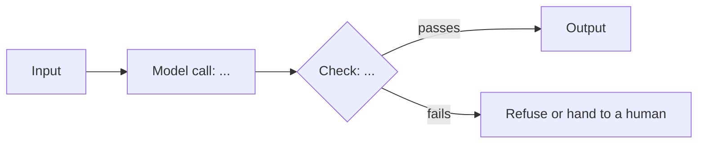

# PLAN: <product name>

Approved by: <mentor's name>, <date>
Plan version: 1
Brief: <MeetingNotes, ResumeCheck, ShopHelp, or "own idea">

## Product

<The product in two sentences: what it does, and for whom.>

## User and job

When <situation>, <user> wants to <job>, so that <outcome>.

## Cost of a wrong answer

- A false answer (the product says something wrong) costs the user: <...>
- A missed answer (the product says nothing, or refuses, when it should answer) costs the user: <...>
- The worse of the two is <...>, because <...>. So the product should lean towards <answering / refusing / asking a human>.

## User stories

Write 6 to 10 stories. Give each an ID and 1 to 3 acceptance criteria you can check with an input and an expected output.

- **S1**: As a <user>, I want <...>, so that <...>.
  - Given <input>, the output <expected result>.
- **S2**: As a <user>, I want <...>, so that <...>.
  - Given <input>, the output <expected result>.
- **S3**: ...

## Must-haves and nice-to-haves

- Must-haves (fit this week and next): S1, S2, ...
- Nice-to-haves (only if time is left): ...

## Flow

One request, from input to answer: the input, each model call, any tool or retrieval, the checks and the output.

## Model choice

- Model: <the setting from the kit's models.md, such as CHAT_MODEL>, because <two reasons from quality, cost, speed and privacy>.
- Fallback model: <...>, used when <...>.
- Other settings (no temperature on Gemini): <for example max_output_tokens, store=False>.

## Evaluation plan

- Number of cases: <25 to 40>, in `evals/cases.json`.
- Case types: <n> normal, <n> edge, <n> hard_rule (at least 5), <n> out_of_scope (at least 3).
- Pass bar for each must-have story:
  - S1: <for example "at least 85% of action items correct">
  - S2: <...>
- How each output is checked: <exact match, field by field, contains, hard-rule check>.

## The hard rule

<The one rule the product must never break.>

How code enforces it (not only the prompt): <the function, where it runs, and what happens when the check fails>.

## Build plan

| Task | Story IDs it delivers |
|---|---|
| Build the core flow | S1, ... |
| Build the second feature | ... |
| Guardrails and injection tests (week 9) | ... |

## Changes

| Date | Plan version | What changed and why |
|---|---|---|
| <date> | 1 | First version, approved by the mentor |
